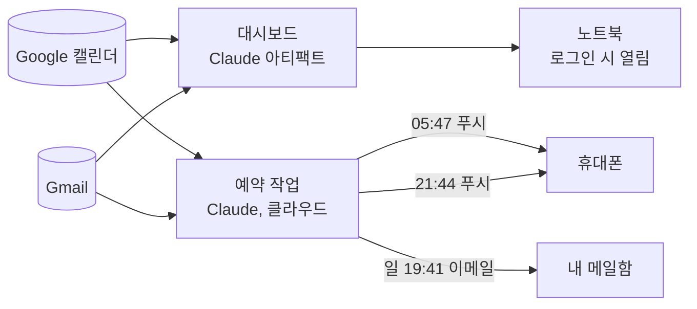

# Life Dashboard

[English](README.md) · **한국어**

> **AI로 만든 프로젝트입니다.** 이 저장소의 코드는 Claude(Anthropic)가 작성했습니다.
> 아이디어, 요구사항, 설계 결정, 테스트와 디버깅은 제가 했습니다.
> 직접 짠 코드의 예시가 아니라, 제가 AI를 활용해 필요한 도구를 만드는 방식을 기록해 두려고 남긴 저장소입니다.

Google 캘린더와 Gmail을 어둡고 차분한 한 페이지에 모아 보여 주는 개인 대시보드입니다. 노트북에 로그인하면 자동으로 열리고, 정해진 시간에 세 가지 알림이 옵니다. 아침 푸시, 전날 밤 푸시, 그리고 일요일 주간 이메일입니다.

## 기능

| 구성 | 내용 | 실행 위치 |
|---|---|---|
| **대시보드** | 오늘 일정 할 일 목록(시간, 색상, 상세 정보), 앞으로 7일, 주요 이메일, 주의할 일(Heads up), 메모장 | Claude 아티팩트. 열 때마다 캘린더와 Gmail을 실시간으로 읽음 |
| **노트북 자동 실행** | Windows 로그인 후 약 5–10초 뒤 대시보드를 앱 창으로 열기 | Windows 시작프로그램 폴더 |
| **아침 브리핑** | 05:47에 오늘 일정만 푸시 | Claude 예약 작업(클라우드) |
| **내일 미리보기** | 21:44에 내일 일정 푸시, 이른 일정 표시 | Claude 예약 작업(클라우드) |
| **주간 미리보기** | 매주 일요일 19:41에 다음 주 일정을 요일별로 정리해 이메일 발송 | Claude 예약 작업(클라우드) |

제가 정한 규칙:
- Google 캘린더에서 **Tomato(토마토)** 색으로 지정한 일정은 중요한 일입니다. 대시보드에서는 빨간색으로 표시되고, 푸시에는 🔴가 붙고, 주간 이메일에서는 맨 앞에 나옵니다.
- **"Important"** 또는 **"중요"**가 들어간 이메일은 강조 표시합니다. 프로모션 메일은 제외합니다.
- 모두 읽기 전용입니다. 일정이나 이메일을 만들거나, 바꾸거나, 지우지 않습니다. 예외는 주간 이메일 하나뿐이고, 제 주소로만 보냅니다.



## 만든 과정

이틀에 걸쳐, 원하는 것을 Claude에게 설명하고, 결과를 제 노트북과 휴대폰에서 직접 써 보고, 잘못된 점을 다시 알려 주는 방식으로 만들었습니다. 제가 요청한 순서는 다음과 같습니다.

1. **아이디어.** 캘린더와 이메일에 연결된 "라이프 대시보드"를 원했습니다. 제가 실행하지 않아도 돌아가야 하므로, 알림은 클라우드 예약 작업이 되었고 대시보드는 스스로 열리는 페이지가 되었습니다.
2. **요구사항.** 부담스럽지 않은 단순한 다크 디자인, 오늘·이번 주·주요 이메일·주의할 일·메모장 위젯, 6:00과 22:00 푸시, 일요일 20:00 나에게 보내는 이메일.
3. **버그: 시작할 때 열리지 않음.** 재부팅했는데 아무것도 열리지 않았습니다. 처음 만든 실행기는 네트워크가 준비되기 전에 브라우저를 열었습니다. 네트워크를 기다리고, Windows 시작 앱 목록에서 항목을 켜고, 다음에 실패하면 원인을 알 수 있도록 로그를 남기게 고쳤습니다.
4. **기능: Tomato = 중요.** 저는 중요한 일을 Google 캘린더에서 Tomato 색으로 표시합니다. 이 규칙이 대시보드, 푸시, 이메일 모두에 적용되도록 요청했습니다.
5. **버그: 휴대폰에 푸시가 오지 않음.** 작업 자체가 실패한 것인지 휴대폰 알림 설정 문제인지 구분하려고 수동 테스트 실행을 요청했습니다.
6. **버그: 아침 푸시에 어제 일정이 나옴.** 원인은 시간대였습니다. 서울 05:47은 UTC로 전날 20:47이고, 작업이 서버의 UTC 시계로 "오늘"을 계산했습니다. 이제 모든 작업이 먼저 서울 시간 기준 날짜를 구하고, 받아 온 일정이 그 날짜인지 확인합니다.
7. **한계: 캘린더 색상.** 캘린더 기본 색을 쓰는 일정이 "Default"로 표시되었습니다. 캘린더 커넥터는 개별 일정에 지정한 색은 알려 주지만, 각 캘린더 자체의 색은 알려 주지 않습니다. 세 캘린더의 색을 한 번 알려 주었고, 지금은 페이지에 직접 적혀 있습니다.
8. **기능: 색상 범례.** 저는 캘린더를 분류(과외, 대외활동, 과제, 개인, 공지)별 색으로 구분합니다. 그래서 오늘 목록 옆에 큰 분류로 묶은 범례를 요청했습니다. 제 색 중 여섯 개(Pistachio, Pumpkin, Cocoa, Mango, Birch, Eucalyptus)는 캘린더 전용 색이라 개별 일정에는 쓸 수 없었습니다. 처음에는 앞으로의 일정을 가장 가까운 일정 색으로 바꿨지만, Google 캘린더 자체가 바뀐 것을 보고 되돌렸습니다. 지금은 Google은 제가 설정한 그대로 두고, 대시보드가 각 일정을 자기 색으로, 색이 없으면 제목으로 분류해 제 실제 색으로 표시합니다.
9. **기능: 빈 시간 찾기.** 날짜를 고르면 그날의 모든 일정과 빈 시간이 보이는 작은 달력을 요청했습니다. 수업 시간은 Google 캘린더에 넣지 않지만 그 시간엔 비어 있지 않습니다. 그래서 수업 시간은 이 위젯 안에만 저장했습니다. 여기서는 바쁜 시간으로 계산하고, 다른 곳에는 전혀 나타나지 않으며, 학기 마지막 날 이후에는 적용되지 않습니다.
10. **기능: 드롭 박스.** 한 기기에서 파일이나 텍스트를 올려 두고 다른 기기에서 받을 수 있고, 정한 기간이 지나면 지워지는 공간을 원했습니다. Claude 페이지는 저장할 수 있는 파일 형식과 다운로드할 수 있는 확장자가 정해져 있어서, 그 밖의 파일(.hwp 등)은 텍스트로 저장했다가 받을 때 원래 파일로 되돌리고, 지원하지 않는 확장자는 .zip으로 묶어 돌려줍니다. 모든 파일이 바이트 단위로 똑같이 돌아오는지 테스트로 확인했습니다.
11. **수정: 휴대폰에서 업로드.** 휴대폰에서 드롭 박스를 눌러도 아무 일도 일어나지 않았습니다. 실제 파일 선택 버튼이 드롭 영역 전체를 덮도록 하고, 업로드가 막히면 이유를 알려 주도록 고쳤습니다. 결국 Claude 휴대폰 앱 자체가 파일 선택을 막는 것이어서, 휴대폰에서는 브라우저로 업로드합니다.
12. **기능: 할 일 목록.** 분류(과제, 시험, 알바, 그 외)를 고를 수 있고, 제목에 오늘 날짜가 표시됩니다. 끝내지 못한 일은 다음 날로 넘어갑니다. 체크한 일은 자정에 숨겨진 보관함으로 옮겨져 되돌릴 수 있고, 24시간 뒤 삭제됩니다. 시각을 기준으로 계산해서 자정에 대시보드가 꺼져 있어도 그대로 적용됩니다. 나중에 선택 사항으로 마감일을 추가했는데, 달력에서 고르지 않고 MM/DD로 직접 입력하며, "Due today", "D-14", "Overdue"로 표시되고 마감이 가까운 일이 먼저 나옵니다.
13. **수정과 한계: 알림.** 2일 뒤 마감인 할 일을 저녁에 따로 알려 달라고 요청했습니다. 테스트해 보니 두 가지 문제가 있었습니다. 저녁 알림이 두 번 왔고(두 경로로 보내고 있었음), 첫 수정에서 잘못된 경로를 남겨 다음 날 밤 알림이 오지 않아서 지금은 작업이 직접 한 번만 보내도록 고쳤으며, 예약 작업은 대시보드 저장소를 읽을 수 없어 할 일을 볼 수 없었습니다. 할 일을 Google 캘린더에 복사하는 대신, D-2 할 일은 알림 없이 대시보드의 Heads up에 표시하기로 했습니다.

느낀 점: 코드는 AI가 빠르게 작성했지만, 위의 버그는 모두 실제로 써 보면서 발견했고 AI의 테스트로는 하나도 잡히지 않았습니다. 제 일의 대부분은 무엇을 해야 하는지 정하고, 제대로 되지 않을 때 그것을 알아차리는 것이었습니다.

## 저장소 구성

```
dashboard/
  life-dashboard.html        대시보드 페이지 (Claude 아티팩트)
windows/
  Install Life Dashboard.cmd 한 번 더블클릭하면 시작프로그램에 추가
  install.ps1                시작프로그램 바로가기를 만들고 켜기
  launch.ps1                 로그인 시 실행: 네트워크를 기다린 뒤 페이지 열기
  Remove from Startup.cmd    되돌리기
scheduled-tasks/
  README.md                  일정과 cron 식
  morning-brief.md           05:47 푸시 프롬프트
  tomorrow-preview.md        21:44 푸시 프롬프트
  weekly-preview-email.md    일요일 이메일 프롬프트
```

## 직접 설정하기

독립 실행형 웹 앱이 아닙니다. 이 페이지는 Claude 아티팩트 런타임(`window.claude.use("mcp")`)으로 보는 사람 본인의 커넥터를 통해 캘린더와 Gmail을 읽습니다. HTML 파일을 브라우저에서 바로 열면 각 섹션이 비어 있습니다.

1. claude.ai에서 **Google Calendar**와 **Gmail** 커넥터를 연결합니다.
2. Claude에게 `dashboard/life-dashboard.html`을 다음 권한으로 아티팩트로 게시해 달라고 요청합니다.
   `mcp` (Google Calendar: `list_calendars`, `list_events`; Gmail: `search_threads`), `db`, `user`, `assets`, `downloads`.
   그다음 `CAL_COLORS`의 캘린더 ID 자리표시자를 본인 것으로 바꾸고 색을 지정합니다.
3. `scheduled-tasks/`의 파일로 예약 작업 세 개를 만들어 달라고 Claude에게 요청합니다. `YOUR_EMAIL@gmail.com`을 바꾸고, 서울이 아니라면 시간대를 조정합니다.
4. Windows에서는 `windows/install.ps1`과 `windows/launch.ps1`의 `YOUR_ARTIFACT_ID`를 본인 아티팩트 링크로 바꾸고, 폴더를 옮기지 않을 곳에 둔 뒤 `Install Life Dashboard.cmd`를 더블클릭합니다.

## 한계

- 커넥터를 가진 계정으로 로그인한 Claude 안에서만 동작합니다.
- 각 캘린더 자체의 색은 직접 입력해야 합니다(위 참고).
- 휴대폰에만 있는 데이터(문자, 기기 내 미리 알림)는 읽을 수 없습니다. Google에 동기화된 것은 읽을 수 있습니다.
- 로그인하거나 재부팅할 때는 열리지만, 노트북이 절전에서 깨어날 때는 열리지 않습니다.

## 만든 사람

- **코드:** [Claude](https://claude.ai)(Anthropic)가 대화를 통해 작성.
- **아이디어, 요구사항, 설계 결정, 테스트, 디버깅:** 저.
