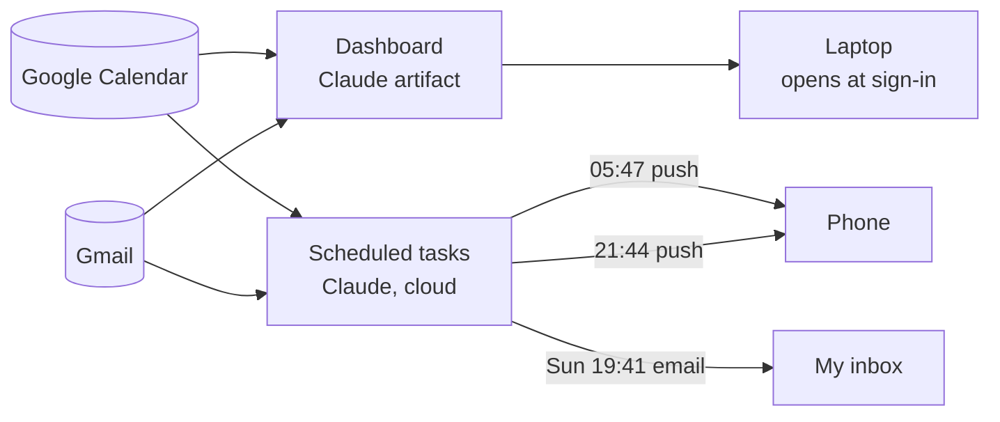

# Life Dashboard

**English** · [한국어](README.ko.md)

> **Made with AI.** The code in this repository was written by Claude (Anthropic).
> The idea, requirements, design decisions, testing and debugging are mine.
> I keep this repo as a record of how I use AI to build tools for myself, not as a sample of code I wrote by hand.

A personal dashboard that pulls my Google Calendar and Gmail into one dark, quiet page. The page opens on its own when I sign in to my laptop. It comes with three scheduled check-ins: a push in the morning, a push the night before, and a weekly email on Sunday.

## What it does

| Part | What it is | Where it runs |
|---|---|---|
| **Dashboard** | One page with today's events as a to-do list (time, color, details), the next 7 days, key emails, a heads-up list and a sticky note | Claude artifact, reading Calendar and Gmail live each time it opens |
| **Laptop launcher** | Opens the dashboard as an app window about 5–10 seconds after Windows sign-in | Windows Startup folder |
| **Morning brief** | Push at 05:47 with today's events only | Claude scheduled task (cloud) |
| **Tomorrow preview** | Push at 21:44 with tomorrow's events, flagging early starts | Claude scheduled task (cloud) |
| **Weekly preview** | Email every Sunday at 19:41 with the week ahead, organized by day | Claude scheduled task (cloud) |

Rules I asked for:
- Events colored **Tomato** in Google Calendar are important tasks. They show in red on the dashboard, get a 🔴 in pushes and are listed first in the weekly email.
- Emails that contain **"Important"** or **"중요"** are highlighted. Promotional email is left out.
- Everything is read-only. Nothing creates, changes or deletes events or emails. The one exception is the weekly email, which goes only to my own address.



## How it was built

I built this over two days by describing what I wanted to Claude, testing the result on my own laptop and phone, and reporting back what was wrong. These were my requests, in order:

1. **The idea.** I wanted a "life dashboard" connected to my calendar and email. Nothing should depend on me starting it, so the reports became cloud scheduled tasks and the dashboard became a page that opens on its own.
2. **The spec.** A simple dark design that doesn't get overwhelming; widgets for today, the week, key emails, heads up and a sticky note; pushes at 6:00 and 22:00; and a Sunday 20:00 email to myself.
3. **Bug: it didn't open at startup.** I restarted and nothing happened. The first launcher started the browser before the network was ready. The fix waits for the network, turns the item on in Windows' Startup apps list, and writes a log so the next failure can be diagnosed.
4. **Feature: Tomato = important.** I color important tasks Tomato in Google Calendar, so I asked for that to carry through to the dashboard, the pushes and the email.
5. **Bug: no push on my phone.** I asked for a manual test run, so I could tell apart whether the task failed or my phone's notification settings were the problem.
6. **Bug: the morning push showed yesterday's events.** The cause was time zones. 05:47 in Seoul is 20:47 the previous day in UTC, and the task worked out "today" from the server's UTC clock. Now every task gets the date in Asia/Seoul time first and checks the events against it.
7. **Limitation: calendar colors.** Events that use their calendar's default color showed as "Default". The Calendar connector reports colors set on single events, but not each calendar's own color. I gave the three calendar colors once, and they are now listed in the page.
8. **Feature: a color key.** I color-code my calendar by category (tutoring, activities, assignments, personal, notices), so I asked for a key next to Today's list, grouped into larger categories. Six of my colors (Pistachio, Pumpkin, Cocoa, Mango, Birch, Eucalyptus) turned out to be calendar-only colors that a single event can't use. At first I had my upcoming events recolored with the closest event colors as stand-ins. When I saw the change in Google Calendar itself, I had it reverted. Now Google stays exactly as I set it. The dashboard sorts each event by its own color, or by its title when it has none, and draws it in my real colors.
9. **Feature: a free-time finder.** I asked for a small month calendar where I can pick any day and see everything on it, plus my free blocks. My class times aren't in Google Calendar, but I'm never free during them. So they're stored only inside this widget. They count as busy there, never show up anywhere else, and stop after the last day of the semester.
10. **Feature: a drop box.** I wanted a place to drop files and text on one device and pick them up on another, deleted after a time I choose. Claude pages can only store a few file types and download a few extensions, so other files (like .hwp) are stored as text and rebuilt on download, and files with unsupported extensions come back inside a .zip. I had it tested to make sure every file comes back byte-for-byte identical.

What I take from this: the AI wrote the code quickly, but every bug above was found by using the thing for real. The AI's tests didn't catch any of them. Most of my work was in deciding what it should do and noticing when it didn't.

## Repository layout

```
dashboard/
  life-dashboard.html        The dashboard page (Claude artifact)
windows/
  Install Life Dashboard.cmd Double-click once to add the launcher to Startup
  install.ps1                Creates the Startup shortcut and turns it on
  launch.ps1                 Runs at sign-in: waits for the network, opens the page
  Remove from Startup.cmd    Undo
scheduled-tasks/
  README.md                  Schedules and cron expressions
  morning-brief.md           Prompt for the 05:47 push
  tomorrow-preview.md        Prompt for the 21:44 push
  weekly-preview-email.md    Prompt for the Sunday email
```

## Setting it up yourself

This is not a standalone web app. The page uses Claude's artifact runtime (`window.claude.use("mcp")`) to read Calendar and Gmail through the viewer's own connectors. If you open the HTML file directly in a browser, the sections stay empty.

1. In claude.ai, connect the **Google Calendar** and **Gmail** connectors.
2. Ask Claude to publish `dashboard/life-dashboard.html` as an artifact with these capabilities:
   `mcp` (Google Calendar: `list_calendars`, `list_events`; Gmail: `search_threads`), `db`, `user`, `assets` and `downloads`.
   Then replace the placeholder calendar IDs in `CAL_COLORS` with your own and set their colors.
3. Ask Claude to create the three scheduled tasks from the files in `scheduled-tasks/`. Replace `YOUR_EMAIL@gmail.com` and adjust the time zone if you are not in Seoul.
4. On Windows, put your artifact link in place of `YOUR_ARTIFACT_ID` in `windows/install.ps1` and `windows/launch.ps1`, keep the folder somewhere permanent and double-click `Install Life Dashboard.cmd`.

## Limitations

- The page only works inside Claude, signed in to the account that owns the connectors.
- Each calendar's own color has to be entered by hand (see above).
- Data that exists only on a phone (texts, local reminders) is not reachable. Anything synced to Google is.
- The launcher opens the dashboard at sign-in or restart, but not when the laptop wakes from sleep.

## Credits

- **Code:** written by [Claude](https://claude.ai) (Anthropic), through conversation.
- **Idea, requirements, design decisions, testing, debugging:** me.
